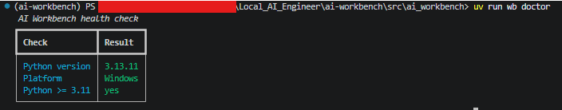

# AI Workbench
 
A local-first AI engineering toolkit built with Python, Typer, Rich, and modern tooling. AI Workbench provides health checks, configuration management, logging, and reusable utilities for developing local AI applications.
 
## Features
 
- Local-first AI development workflow
- Professional Python project structure
- Environment-based configuration management
- Rich terminal interfaces
- Health-check diagnostics
- Type-safe settings management
- Automated testing and linting
 
## Installation
 
git clone https://github.com/Constantinos-uni/ai-workbench.git
cd ai-workbench
 
uv sync
uv pip install -e .

## Quick Start

1. Run a quick health check (under \\src\\ai_workbench): uv run wb doctor

## Development

### check:
uv run ruff check src/
 
### format:
uv run ruff format src/
 
### test:
uv run pytest -q
 
### doctor:
uv run wb doctor