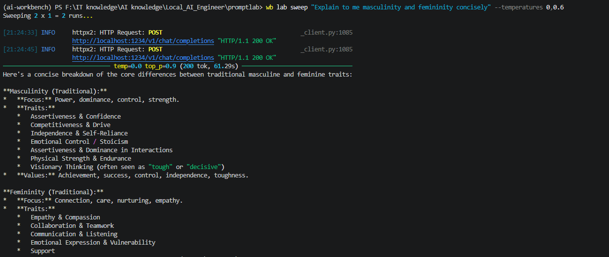
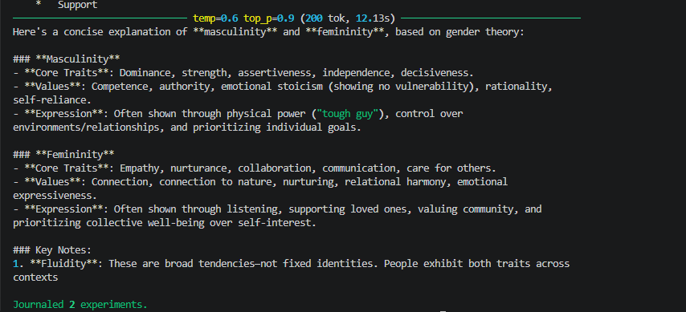
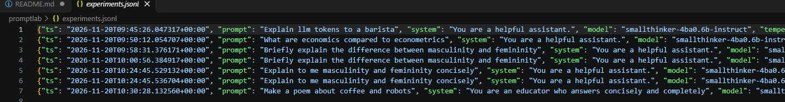
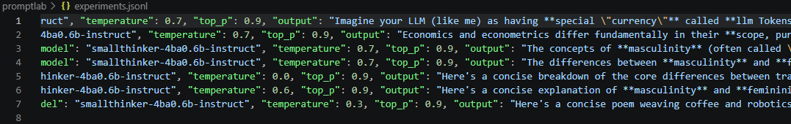

# promptlab - Chapter 2 Project

**A prompt experimentation lab for local language models.** One prompt, swept across
parameter grids — every run measured (tokens, latency) and journaled to disk.
Repeatable. Comparable. No guessing whether the model "felt" better yesterday.




## Why it exists

Prompts are experiments, and experiments you don't record are superstition.
promptlab turns "I think temperature 0.8 is better" into a table you can show someone, recorded under promptlab\experiments.jsonl as displayed, showing the record and temperature that defines response quality/characteristics!




## The real-world problem it solves

Prompts are experiments, and experiments you don’t record are superstition. Every working AI engineer has asked “was the model better before I changed the system prompt, or am I imagining it?” promptlab ends the guessing: a CLI that runs one prompt across a sweep of parameter combinations, prints the results side by side, and saves every run -prompt, parameters, output, token usage, timestamp -to a JSONL journal (JSON Lines: one JSON object per line; append-friendly, greppable, and every data tool on earth reads it). When someone asks “why does the assistant phrase it that way?”, you show them the experiment log instead of shrugging.

## Requirements

- Python 3.11+
- A local OpenAI-compatible server: [LM Studio](https://lmstudio.ai) (default,
  `http://localhost:1234/v1`), Ollama (`:11434`), or llama.cpp (`:8080`)

## Install

```bash
git clone https://github.com/yourusername/promptlab.git
cd promptlab
uv pip install -e .
cp .env.example .env   # point OPENAI_BASE_URL at your server, set LOCAL_MODEL